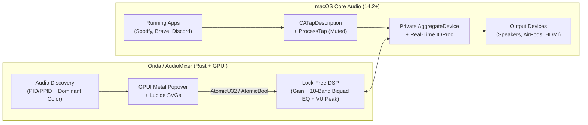

# Onda (AudioMixer) — Native Per-App Volume Mixer & 10-Band EQ for macOS

<p align="center">
  <strong>Control individual application volume, output routing, and real-time 10-band equalization from your macOS menu bar — built in 100% Rust with GPUI & Core Audio Process Taps.</strong>
</p>

<p align="center">
  
  
  
  
  
</p>

---

## ✨ Features (`v0.1.0` MVP)

- **Zero Virtual Audio Drivers Required:** Uses Apple's native **Core Audio Process Tap API** (`AudioHardwareCreateProcessTap`, macOS 14.2+) to intercept, scale, and route per-application audio without installing kernel extensions or HAL drivers like BlackHole.
- **120Hz Metal-Accelerated Glassmorphic UI:** Built with Zed's **GPUI** framework and official **Lucide SVG** vector icons, featuring Dark, Light, and Auto themes plus Transparent (frosted glass) and Solid window styles.
- **Dynamic App-Colored Sliders:** Automatically extracts the dominant vibrant color from each running application's `.app` icon (Spotify green, Chrome blue, Brave orange, Discord blurple) and styles its slider accordingly.
- **Smart Browser & Helper Process Grouping:** Automatically resolves Chromium/Brave/Electron audio helper subprocesses (`ppid` chain) back to their parent application.
- **Real-Time 10-Band Biquad Equalizer (`32Hz` – `16kHz`):**
  - Lock-free stereo peaking biquad filter bank running directly inside the Core Audio `IOProc`.
  - Apply equalization **globally** or click any active application to customize its **per-app EQ** curve + built-in presets (*Flat*, *Bass Boost*, *Vocal Clarity*, *Electronic*, *Acoustic*).
- **Per-App Output Device Routing & Volume Boost:** Route specific apps to different output devices (e.g., Spotify to Bluetooth speakers while Brave plays on headphones) and boost quiet apps up to **200%**.
- **Real-Time VU Metering:** 5-bar LED peak meter per application powered by lock-free atomic peak tracking.
- **Launch at Login & Persistent Preferences:** Native macOS `LaunchAgent` integration and automatic state persistence in `~/Library/Application Support/Onda/volumes.json`.
- **GitHub Releases Auto-Updater:** Background and manual update checks against GitHub Releases (`maximux13/onda`), in-app `.app` bundle replacement, and one-click relaunch.

---

## 🏗️ Architecture



---

## 🚀 Getting Started

### Requirements
- **macOS 14.2 (Sonoma)** or newer (tested on macOS Sequoia / Tahoe)
- **Rust 1.85+** (`rustup`)

### Build & Run (`.app` Bundle)

```bash
# Clone the repository
git clone https://github.com/maximux13/onda.git
cd onda

# Build and ad-hoc codesign the macOS .app bundle
./scripts/bundle_app.sh release

# Launch the menu bar app
open target/release/Onda.app
```

> **Note on macOS Permissions:** The first time you adjust an application's volume or EQ, macOS will prompt for **System Audio Recording** permission (`NSAudioCaptureUsageDescription`). Grant it in **System Settings → Privacy & Security → Audio Recording** so Core Audio Process Taps can intercept audio streams.

### Testing Auto-Updates Locally

You can test the full download, `.app` bundle replacement, and relaunch flow against a local mock GitHub Releases server without publishing a real tag:

```bash
# Builds debug Onda.app, packages a mock v99.0.0 release zip, starts a local HTTP server,
# and launches Onda with updater overrides pointing to http://127.0.0.1:8787
./scripts/test_updater_local.sh

# Optionally pass a custom fake version or port:
ONDA_TEST_PORT=8787 ./scripts/test_updater_local.sh 1.2.3
```

The updater honors three optional environment variables for local testing:
- `ONDA_UPDATE_API_URL`: Overrides the GitHub API base URL (e.g., `http://127.0.0.1:8787`).
- `ONDA_UPDATE_CURRENT_VERSION`: Overrides the reported current app version (e.g., `0.1.0`).
- `ONDA_UPDATE_INSTALL_PATH`: Overrides the target `.app` bundle path to replace.

---

## 🗺️ Roadmap & Future Updates

### `v0.2.0` — Global Shortcuts & Audio Ducking
- [ ] **Global Keyboard Shortcuts:** Register system-wide hotkeys (`CGEventTap` / `global-hotkey`) to mute active app, cycle output devices, or open the mixer popover.
- [ ] **Per-Input Microphone Control:** Mute and gain slider for input devices (`MacBook Pro Microphone`, external USB mics) from the top bar.
- [ ] **Auto-Ducking:** Automatically lower music volume (e.g., Spotify) when voice apps (Discord, Zoom, Meet) output audio.

### `v0.3.0` — Audio Recording & Custom EQ Profiles
- [ ] **Custom User EQ Presets:** Save, import, and export custom 10-band EQ curves.
- [ ] **Quick App Audio Recorder:** Record individual app audio streams directly to `.wav` / `.m4a` from the mixer row.
- [ ] **Multi-Device Simultaneous Output:** Play a single app through two headphones simultaneously.

### `v1.0.0` — Distribution & Polish
- [ ] **Homebrew Cask (`brew install --cask onda`)**
- [ ] **Apple Developer ID Code Signing & Notarization**
- [x] **GitHub Releases Auto-Updater** (`self_update` + in-app `.app` bundle replacement & relaunch)
- [ ] **Unit & Integration Test Suite** (DSP biquad frequency response, preference serialization, HSV dominant color extraction)

---

## 📄 License

Released under the [MIT License](LICENSE).
